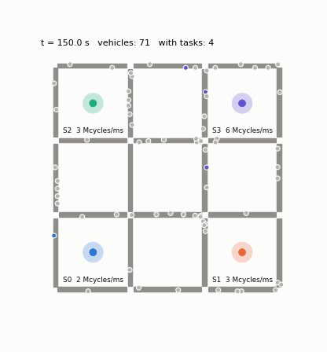
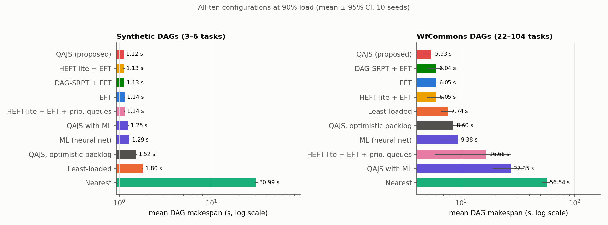
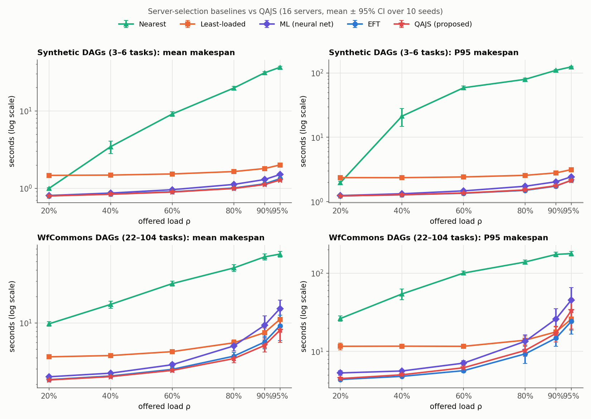
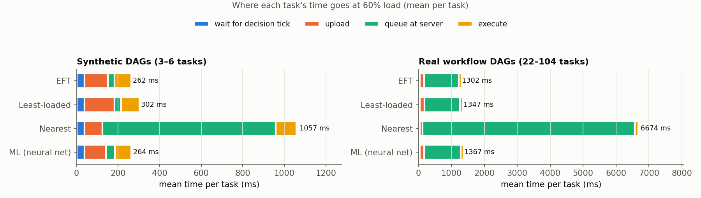
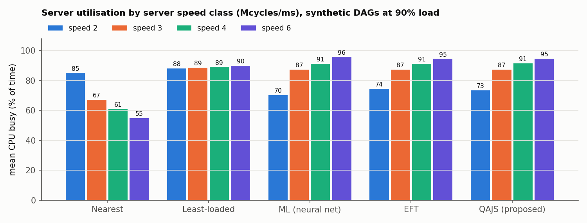
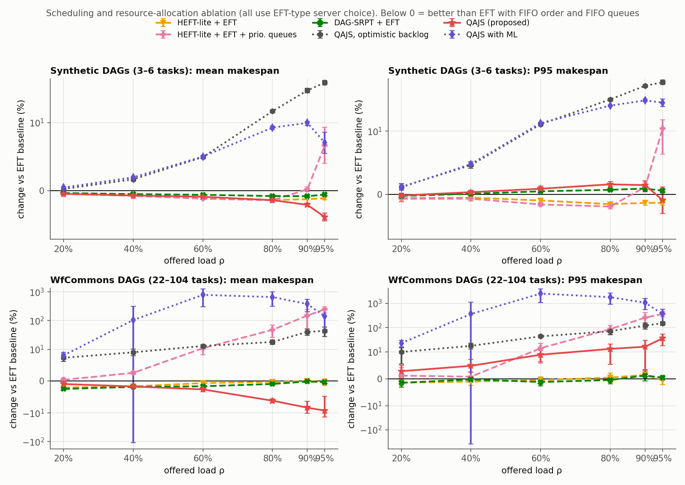
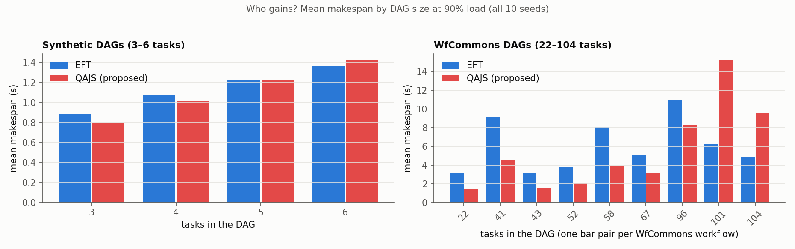
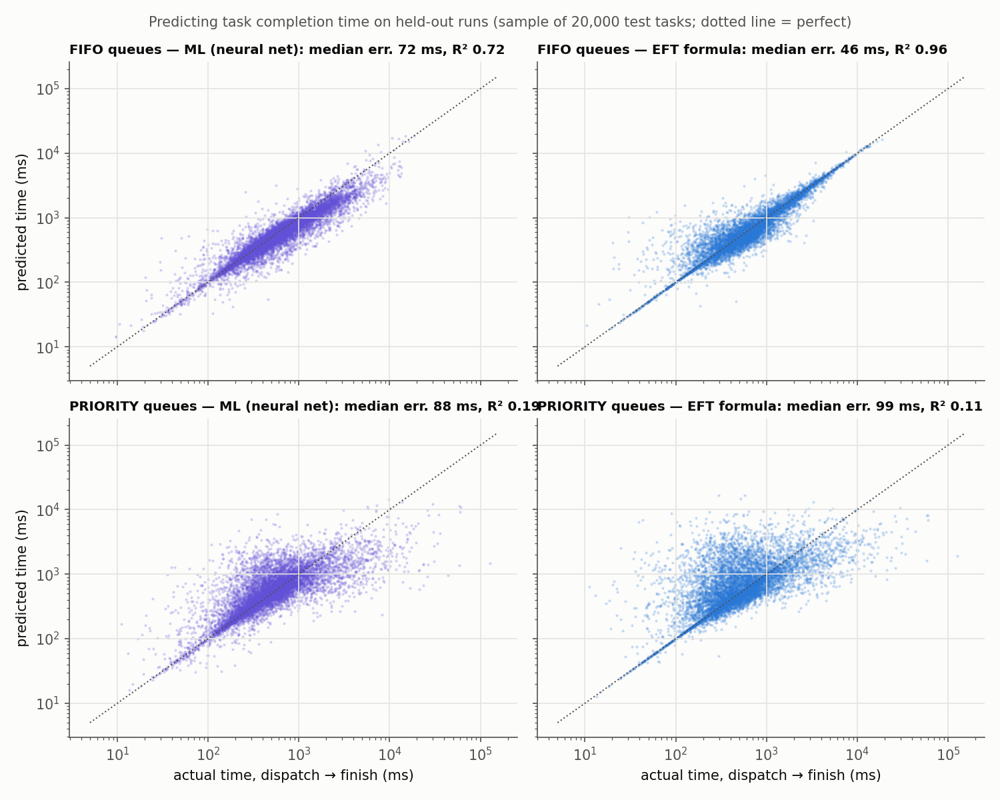

# QAJS: Queue-Aware DAG Scheduling and Offloading for Connected Vehicles

Vehicles run applications made of dependent tasks (a **DAG**, e.g.
*sense → detect → plan*) and offload those tasks over a wireless link to
**edge servers** beside the road. This project simulates that on a SUMO city
and answers three questions online, every 0.1 s:

1. **Scheduling:** which waiting task goes first?
2. **Server selection (offloading):** which edge server runs it?
3. **Resource allocation:** which queued task gets a server's CPU next?

The goal is to minimise the **makespan**: the time from an application's
arrival until its last task finishes.

Our framework, **QAJS**, answers all three with one shared priority:
*the application closest to completion goes first* (DAG-SRPT), servers are
chosen by **earliest estimated finish time** (EFT) from live queue backlogs and
each vehicle's current link, and servers run their queues **in priority order**.



*1.75 km × 1.75 km SUMO city with 16 edge servers (colour = server speed).
A vehicle takes the colour of the server running its application.*

---

## Results in short

**1,200 SUMO runs, 45.9 million tasks**, 16 heterogeneous servers, about
300–760 vehicles on the road, two workloads (synthetic DAGs and real
workflow DAGs from the public WfCommons dataset), loads from 20% to 95%.

- **QAJS has the lowest mean makespan in 8 of 12 settings**, including every
  heavy-load setting (90% and 95%). Elsewhere it is within 0.3% of the best,
  except WfCommons at 20% load (1.6% behind).
- **The benefit grows with congestion.** Compared with EFT alone, QAJS is
  0.5% → 4.0% faster on synthetic DAGs and 0.9% → 10.7% faster on WfCommons
  DAGs as load rises from 20% to 95% (paired by seed).
- **Simple rules fail:** Least-loaded is 33–84% slower; Nearest is up to
  29× slower.
- **ML baseline** (neural network that predicts completion time): better
  than the simple rules but 1–78% slower than QAJS. Inside the QAJS
  framework it becomes unstable on the real DAGs (23% of applications unfinished).
- **The ablation shows the gain comes from the combination** of DAG-SRPT
  priorities and priority queues. HEFT's priority with priority queues is
  harmful (up to +288%).
- **Trade-off:** QAJS favours small applications. On WfCommons the largest
  workflows finish later, and the 95th-percentile makespan is up to 24%
  worse than EFT's.

Numbers: `results/summary.csv` (every run), `results/aggregate.csv`
(means and 95% CIs), `results/paired_vs_qajs.csv`, `results/paired_vs_eft.csv`.



---

## How it works

```
 SUMO (traffic) ──positions──► iov_sim, every 0.1 s:
   1. read every vehicle's position over TraCI
   2. run the servers forward; finished tasks unlock their children
   3. new applications (DAGs) arrive at random, each owned by a random vehicle
   4. SCHEDULER gives each waiting task a priority and orders them
      → SERVER SELECTION picks a server for each
      → SERVERS run their queues by priority (RESOURCE ALLOCATION)
   5. log metrics
```

A task's life: *ready → wait for decision tick → upload (latency + data ÷ rate,
both depend on distance) → queue at server → execute (work ÷ server speed) → done.*

| Decision | Options | QAJS uses |
|---|---|---|
| Scheduling (`--scheduler`) | `fifo`, `heft` (HEFT upward rank), `srpt` (DAG-SRPT) | `srpt` |
| Server selection (`--offloading`) | `nearest`, `least_loaded`, `eft`, `ml` | `eft` |
| Resource allocation (`--server-queue`) | `fifo`, `priority` | `priority` |

Key formulas (full model, formulation and proofs are in the report):

```
upload time     τ_up  = 2 ms + 0.05 ms/m · distance + data / (5 KB/ms / (1 + distance/200 m))
EFT estimate    F̂(s)  = max(τ_up(s), backlog(s) / speed(s)) + work / speed(s)
DAG-SRPT        π(i)  = remaining work of i's application − 10⁻⁶ · upward rank(i)
```

| Part | Folder |
|---|---|
| Scheduling (FIFO, HEFT-lite, DAG-SRPT, workloads) | [`src/scheduling/`](src/scheduling/README.md) |
| Server selection (EFT, Least-loaded, Nearest, ML) | [`src/offloading/`](src/offloading/README.md) |
| Server queues (FIFO / priority) | [`src/resource_mgmt/`](src/resource_mgmt/README.md) |
| SUMO / TraCI, link model, scenarios | [`simulation/sumo_integration/`](simulation/sumo_integration/README.md) |
| ML baseline | [`ml/`](ml/README.md) |
| Public dataset (WfCommons) | [`data/`](data/README.md) |

---

## Experimental setup

| | |
|---|---|
| City | SUMO 8×8 grid, 250 m blocks (1.75 km × 1.75 km), traffic lights |
| Traffic | 2,000 trips, one every 0.3 s; 300–760 vehicles on the road (581 on average) |
| Edge servers | 16 on a 4×4 lattice; four each of speed 2, 3, 4, 6 Mcycles/ms |
| Synthetic DAGs | 3–6 tasks, 1–2 dependencies each, 100–500 Mcycles, 50–400 KB |
| Real DAGs | 9 WfCommons workflows (Montage, Epigenomics, 1000Genome, BLAST, …), 22–104 tasks, rescaled to vehicle-sized tasks |
| Load | 20, 40, 60, 80, 90, 95% of total server capacity |
| Per run | 100 s warm-up, 300 s of arrivals, ≤120 s drain; 11,000–61,000 tasks |
| Benchmark | 10 configurations × 2 workloads × 6 loads × 10 seeds = 1,200 runs |

The 10 configurations: Nearest, Least-loaded, ML, EFT (all with FIFO order
and FIFO queues); HEFT-lite + EFT, HEFT-lite + EFT + priority queues,
DAG-SRPT + EFT, QAJS with an optimistic backlog estimate, **QAJS**, and QAJS
with the ML model instead of EFT.

---

## Results

### Server selection



Mean makespan in seconds at 90% / 95% load (10 seeds):

| | Synthetic 90% | Synthetic 95% | WfCommons 90% | WfCommons 95% |
|---|---:|---:|---:|---:|
| **QAJS** | **1.12** | **1.27** | **5.53** | **8.24** |
| EFT | 1.14 | 1.33 | 6.05 | 9.27 |
| ML (neural net) | 1.30 | 1.50 | 9.39 | 14.57 |
| Least-loaded | 1.80 | 2.00 | 7.74 | 10.95 |
| Nearest | 31.0 | 36.6 | 56.5 | 60.8 |

**Why:** Nearest piles work onto servers near busy roads, so tasks wait in
long queues. Least-loaded ignores distance and pays long uploads. EFT
balances upload, queueing and server speed in one estimate.




### Ablation: where the gain comes from



- Changing only the dispatch order (DAG-SRPT or HEFT-lite with FIFO queues)
  changes little: within about ±2% of EFT.
- DAG-SRPT **plus** priority queues (QAJS) improves steadily as load grows.
- HEFT's priority with priority queues is harmful: it favours applications
  with the most work left, the opposite of what minimises the mean.
- Estimating the backlog optimistically (only higher-priority work) makes
  EFT overcommit fast servers: 51–58% worse at 95% load.

### Who gains, who pays



QAJS roughly halves the makespan of most WfCommons workflows, but the two
widest (101 and 104 tasks) take about twice as long. Shortest-remaining-work
policies trade tail latency for mean latency.

### ML baseline



With FIFO queues, EFT's formula predicts completion time almost exactly
(R² 0.96) and the neural network does not reach it (R² 0.72). With priority
queues neither predicts well (R² ≤ 0.19): a task's wait depends on future
arrivals that jump ahead. Details in [`ml/README.md`](ml/README.md).

---

## Limitations

- **The link is a formula** (distance → latency and rate). There is no
  interference, shared bandwidth or handover. Vehicle positions are real
  (SUMO). EFT uses the same formula as the simulator, which is an advantage
  over the ML model.
- No execution on the vehicle, no result download, and no data transfer
  between servers for dependent tasks.
- Decisions every 0.1 s add about 40 ms per task (same for every policy).
- QAJS improves the mean at the cost of the tail for the largest WfCommons workflows.
- WfCommons DAGs are scientific workflows rescaled to vehicle-sized tasks.
  One city and one server layout were tested.
- Averages exclude unfinished applications. That affects Nearest, ML, and QAJS with ML.

---

## Run it yourself

Full step-by-step instructions: **[HOW_TO_RUN.md](HOW_TO_RUN.md)**.

```bash
python -m pip install -r requirements.txt     # SUMO, plotting, scikit-learn
python data/prepare_wfcommons.py              # download the public dataset
cmake -S . -B build && cmake --build build    # build the simulator
python run_experiment.py                      # one QAJS run on the city
python run_experiment.py --gui                # watch it in sumo-gui
python run_experiment.py --sweep --jobs 14    # all 1,200 runs (~1.5-2 h)
python plot_results.py                        # the figures above
```

## Project layout

```
main.cpp                    simulator driver (builds to iov_sim)
run_experiment.py           starts SUMO + iov_sim; single runs, --gui, --sweep
plot_results.py             figures, aggregate.csv, paired_vs_*.csv
visualize.py                network snapshot and animation
src/scheduling/             FIFO, HEFT-lite, DAG-SRPT, DAG workloads
src/offloading/             EFT, Least-loaded, Nearest, ML
src/resource_mgmt/          server queues (FIFO / priority)
simulation/sumo_integration TraCI client, SUMO bridge, mock mobility, link model
sumo_scenario/              city and small scenarios + make_scenario.py
ml/                         ML training script, trained model, report
data/                       WfCommons dataset preparation
tests/run_tests.cpp         unit tests (ctest)
results/                    summary.csv, aggregate.csv, paired tables, plots/
docs/PROGRESS.md            status and history of fixes
```
