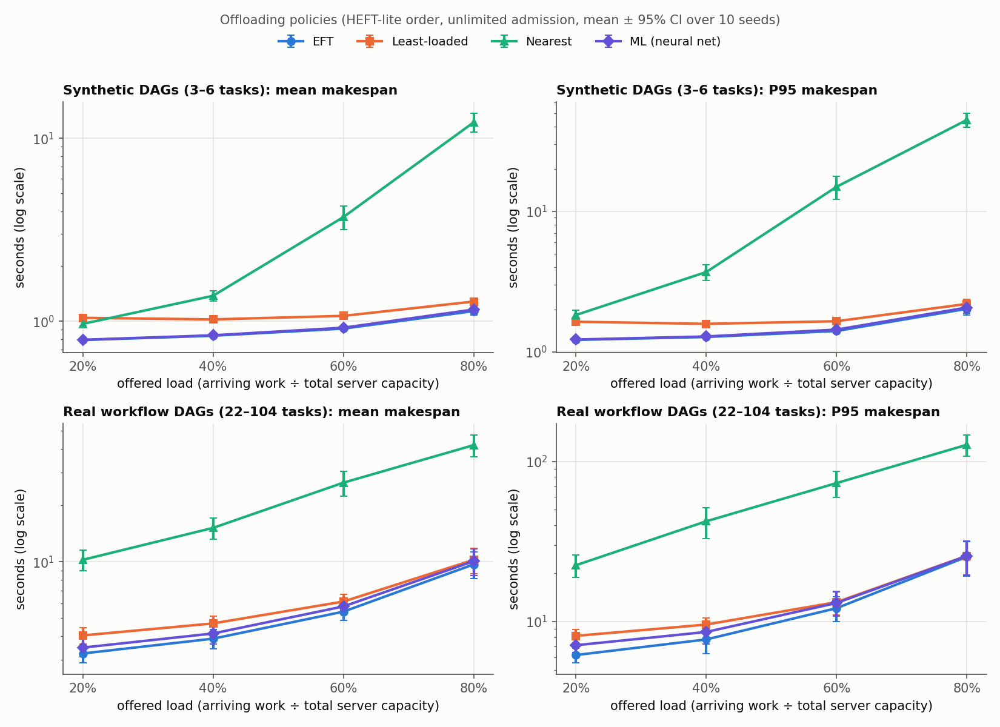
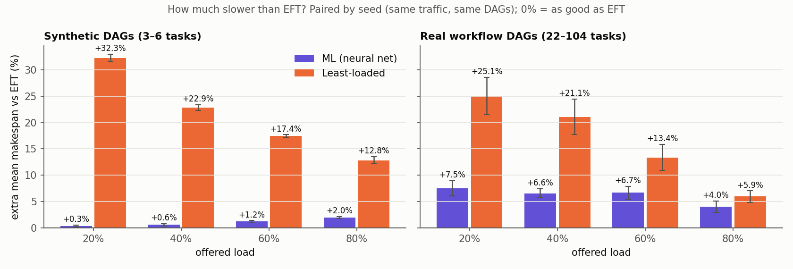
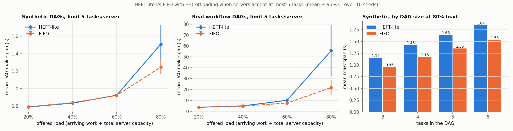
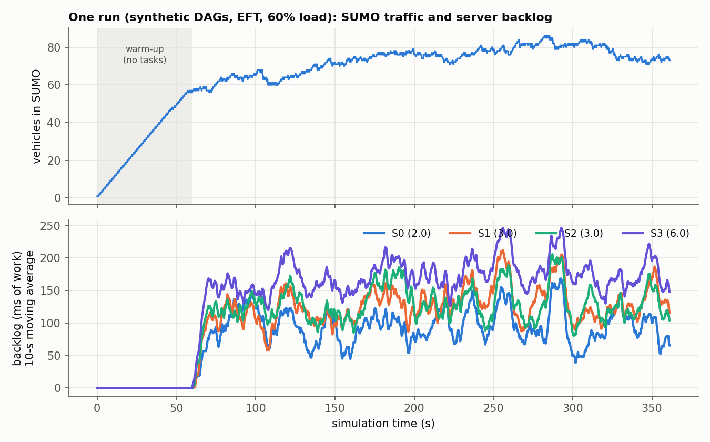

# DAG Task Scheduling and Offloading for Connected Vehicles

Vehicles generate small applications made of dependent tasks (a **DAG**:
for example *sense → detect → plan*). Each task is sent over a wireless link
to one of four **edge servers** beside the road. This project simulates that,
using **real vehicle movement from the SUMO traffic simulator**, and compares
ways of deciding:

1. **Which server runs each task** (offloading). Our policy is **EFT**
   (Earliest Finish Time). It is compared against two simple rules and a
   **machine-learning (ML) baseline**: a neural network trained to predict
   task finish times.
2. **Which waiting task goes first** (scheduling): *HEFT-lite* vs *FIFO*.

The policies are tested on two workloads: small random DAGs, and **real
workflow DAG structures from the public WfCommons dataset**. The goal is a
short **makespan**: the time from a DAG's arrival until its last task is
finished.


*Vehicles from SUMO on a 600 m × 600 m grid. The four coloured circles are
edge servers. A vehicle takes a server's colour while its tasks run there.*

---

## Results in short

- **EFT gives the shortest makespan in every setting tested:** both
  workloads, all four load levels, and in 79 of 80 paired seed comparisons
  against the ML baseline.
- **The ML baseline comes second.** It is 0.3–2% slower than EFT on the
  synthetic DAGs and 4–7.5% slower on the real workflow DAGs, but clearly
  better than the two simple rules.
- **Least-loaded** (ignores distance) is 6–32% slower than EFT.
  **Nearest** (ignores load) collapses as load grows: up to 11× slower.
- **HEFT-lite vs FIFO:** when servers accept every task, HEFT-lite is
  slightly faster (0.3–1.2%). When servers only accept 5 tasks at a time
  and load is high, HEFT-lite is much *worse* (20% on synthetic, 140% on
  real DAGs at 80% load), because it keeps starting new DAGs instead of
  finishing old ones.

All results are means over 10 seeds with 95% confidence intervals, from
560 simulation runs (`results/summary.csv`, `results/aggregate.csv`,
`results/paired_vs_eft.csv`).

---

## How it works

```
 SUMO (traffic)  ──positions──►  iov_sim  (every 0.1 s of simulated time)
                                  │
   1. advance SUMO one step, read every vehicle's position
   2. run the edge servers forward; finished tasks unlock their children
   3. new DAGs arrive at random, each owned by a random vehicle
   4. SCHEDULER sorts all waiting tasks  ─►  OFFLOADING POLICY picks a server for each
   5. log metrics
```

Each task goes through these steps:

```
ready ──► wait for a decision ──► upload over the vehicle's link ──► queue at server ──► execute ──► done
          (next 0.1 s tick)       (latency + data ÷ rate,             (FIFO)              (work ÷ server
                                   both depend on distance)                                speed)
```

| Part | Folder | What it does |
|---|---|---|
| Scheduling | [`src/scheduling/`](src/scheduling/README.md) | HEFT-lite, FIFO, workloads (random and real DAGs) |
| Offloading | [`src/offloading/`](src/offloading/README.md) | EFT, Least-loaded, Nearest, ML |
| Servers | [`src/resource_mgmt/`](src/resource_mgmt/README.md) | Exact FIFO queues with an upload phase |
| Mobility | [`simulation/sumo_integration/`](simulation/sumo_integration/README.md) | TraCI client for SUMO, mock mobility, link model |
| ML model | [`ml/`](ml/README.md) | Training script and the trained neural network |
| Dataset | [`data/`](data/README.md) | Script that builds the real-DAG workload from WfCommons |
| Driver | `main.cpp` | Ties everything together and writes CSV results |

### The policies

| Offloading policy | Chooses the server with… |
|---|---|
| **EFT** (ours) | the earliest estimated finish time: `max(upload, backlog) + work ÷ speed`, all in ms |
| **ML** (neural network) | the lowest finish time *predicted by a trained neural network* from raw inputs (distance, data size, work, server speed, server backlog, tasks at server) |
| **Least-loaded** | the shortest backlog (pending work ÷ speed); ignores distance |
| **Nearest** | the lowest link latency; ignores load |

| Scheduler | Waiting tasks are dispatched… |
|---|---|
| **HEFT-lite** | highest *upward rank* first, i.e. the task with the longest remaining chain of work after it in its DAG (the ordering step of the HEFT algorithm) |
| **FIFO** | in the order they became ready |

---

## Experimental setup

| | |
|---|---|
| Road network | SUMO 4×4 grid, 200 m blocks (600 m × 600 m) |
| Traffic | 500 random trips, 1 departure per second; 56–86 vehicles on the road during the measurement |
| Edge servers | 4, near the corners: S0 2.0, S1 3.0, S2 3.0, **S3 6.0** Mcycles/ms (S3 is the fast one) |
| Synthetic workload | random DAGs of 3–6 tasks; each task depends on 1–2 earlier ones; work 100–500 Mcycles; input 50–400 KB |
| Real-DAG workload | 9 real workflows from [WfCommons](https://github.com/wfcommons/WfInstances) (Montage, Epigenomics, 1000Genome, BLAST, …), 22–104 tasks each; real structure and relative task sizes, rescaled to the same mean work and data as the synthetic tasks ([details](data/README.md)) |
| Load | 20%, 40%, 60%, 80% of total server capacity (Poisson arrivals for 300 s after a 60 s warm-up) |
| Link model | latency = 2 ms + 0.05 ms/m; upload rate = 5 KB/ms ÷ (1 + distance / 200 m) |
| Admission | unlimited, or at most 5 tasks per server (scheduler experiment only) |
| ML training | separate seeds (1001–1004) from the evaluation seeds (1–10); see [ml/README.md](ml/README.md) |
| Repetitions | 10 seeds per configuration, 560 runs in total |

"Load" counts only CPU work. Upload times come on top, so 80% load is
already close to what the servers can handle.

---

## Results

### 1. Offloading benchmark: EFT vs ML vs simple rules



Mean DAG makespan in seconds (HEFT-lite order, unlimited admission, ± 95% CI):

| Load | EFT (ours) | ML | Least-loaded | Nearest |
|---:|---:|---:|---:|---:|
| **Synthetic DAGs** | | | | |
| 20% | **0.79** ± 0.01 | 0.79 ± 0.01 | 1.05 ± 0.01 | 0.97 ± 0.03 |
| 40% | **0.83** ± 0.01 | 0.84 ± 0.01 | 1.02 ± 0.01 | 1.38 ± 0.09 |
| 60% | **0.91** ± 0.01 | 0.92 ± 0.01 | 1.07 ± 0.01 | 3.71 ± 0.55 |
| 80% | **1.14** ± 0.05 | 1.16 ± 0.05 | 1.28 ± 0.05 | 12.2 ± 1.5 |
| **Real workflow DAGs** | | | | |
| 20% | **3.24** ± 0.35 | 3.49 ± 0.38 | 4.05 ± 0.40 | 10.3 ± 1.3 |
| 40% | **3.89** ± 0.45 | 4.15 ± 0.49 | 4.69 ± 0.44 | 15.2 ± 2.0 |
| 60% | **5.42** ± 0.54 | 5.78 ± 0.55 | 6.14 ± 0.57 | 26.4 ± 4.1 |
| 80% | **9.69** ± 1.58 | 10.08 ± 1.63 | 10.24 ± 1.59 | 41.9 ± 5.5 |

The confidence intervals overlap for EFT and ML because the runs differ a
lot from seed to seed (different traffic and different DAGs). Comparing the
two policies **on the same seed** removes that noise and shows the gap
clearly:



| | ML vs EFT | Least-loaded vs EFT |
|---|---|---|
| Synthetic DAGs | +0.3% to +2.0% slower (EFT better in 39 of 40 runs) | +13% to +32% slower |
| Real workflow DAGs | +4.0% to +7.5% slower (EFT better in 40 of 40 runs) | +6% to +25% slower |

**Why EFT beats the ML model.** Both make the same kind of decision (pick
the server with the earliest finish time). The difference is how the finish
time is estimated. EFT computes it from a formula built on how uploads and
queues work. The ML model has to learn it from examples, and its
predictions are less precise: on held-out data its median error is 70 ms
versus 8 ms for EFT's formula.


To be fair to the ML model: the simulator uses exactly the link and server
equations that EFT's formula is based on, so EFT has a home advantage here.
With real radio links and real servers, where no exact formula exists, a
learned model could do relatively better. This benchmark does not test that
(see [Limitations](#limitations)).

**Why the simple rules lose:** the time breakdown at 60% load shows it.


- **Nearest** has the shortest uploads but tasks wait in long queues:
  834 ms per task on synthetic DAGs, 6.5 s on real DAGs. The slow server S0
  is busy 96% of the time while the fast server S3 is busy only 34%.
- **Least-loaded** avoids queues but uploads take longer (144 ms vs 113 ms
  for EFT) because it ignores distance.
- **EFT and ML** balance the two. ML chooses slightly closer servers
  (102 ms uploads) but queues a little longer (43 ms vs 31 ms).
- The ~39 ms *wait for decision tick* is the same for all policies:
  decisions are made every 0.1 s.
- On the real DAGs, queueing dominates for every policy. Wide workflows
  release dozens of tasks at once, which all have to wait their turn.


### 2. Scheduler: HEFT-lite vs FIFO

With unlimited admission every waiting task is dispatched immediately, so
the order only decides who is first in each server's queue. Paired by seed,
HEFT-lite is slightly faster: by 0.3–0.6% on synthetic DAGs and up to 1.2%
on real DAGs.

To give the scheduler more influence, the second setting limits each server
to 5 tasks at a time (uploading, queued or running). Tasks that find no
free server wait centrally, in the order the scheduler chooses.



| Load | Synthetic: HEFT-lite vs FIFO | Real DAGs: HEFT-lite vs FIFO |
|---:|---:|---:|
| 20% | −0.3% ± 0.2 | −0.7% ± 4.2 |
| 40% | −0.6% ± 0.2 | +4.3% ± 2.5 |
| 60% | +0.2% ± 0.6 | +32% ± 13 |
| 80% | **+20% ± 8** | **+141% ± 39** |

*(Change in mean makespan with the 5-task limit, paired by seed. Negative = HEFT-lite faster.)*

Under heavy load HEFT-lite is much worse. A newly arrived DAG's first task
always has the highest rank (its whole DAG is still ahead of it), so new
DAGs keep jumping ahead of the last tasks of older DAGs. Every DAG then
takes longer, whatever its size. HEFT's ranking was designed to order the
tasks of *one* DAG, not many DAGs competing for the same servers. The
admission limit itself also costs time on the real DAGs: with FIFO at 80%
load the mean makespan rises from 9.7 s (no limit) to 21.8 s.

### 3. One run over time



Traffic builds up during the 60 s warm-up and then stays between roughly
55 and 85 vehicles. With EFT the fast server S3 carries the most work (45%
of all tasks at 60% load), and every server's backlog stays well under a
second.

---

## Limitations

These matter for interpreting the results:

- **The link model is a simple formula**, not a network simulator: no
  interference, no bandwidth shared between vehicles, no handover. Vehicle
  positions are real (from SUMO); link quality is modelled.
- **EFT has a home advantage over ML**, because the simulator follows the
  same equations EFT's formula is built on. The ML baseline is also kept
  simple: supervised learning from random exploration, with no
  reinforcement learning and no retraining on its own decisions.
- **The real-DAG workload is real in structure, not in scale.** The
  WfCommons workflows are scientific computing pipelines, rescaled to
  vehicle-sized tasks. They test the policies on realistic DAG shapes and
  uneven task sizes; they are not recordings of vehicle applications.
- **Tasks cannot run on the vehicle itself**, and sending results back is
  not modelled.
- **Each task uploads its own input from the vehicle.** Data passed between
  dependent tasks on different servers is not modelled.
- **Decisions happen every 0.1 s**, which adds about 39 ms per task.
- If a vehicle leaves the map before its DAG is finished, its last known
  position is used. This affected 2% of synthetic DAGs and 13% of real
  DAGs on average (those take longer), and up to 44% for Nearest at 80% load.
- **Nearest at 80% load on real DAGs left 27 DAGs unfinished** (in 3 of 10
  runs). They are not counted in its makespan, so its real result there is
  even worse than shown.
- One road network and one server layout. Exact numbers depend on the
  compiler's random-number implementation (GCC 15, MSYS2, Windows here).

The first version of this project had several modelling errors (for
example, every task finished in exactly one tick, and link latency was
never added to task time). See [`docs/PROGRESS.md`](docs/PROGRESS.md) for
the fixes.

---

## Run it yourself

Step-by-step instructions for Windows, Linux and macOS are in
**[HOW_TO_RUN.md](HOW_TO_RUN.md)**. In short:

```bash
python -m pip install -r requirements.txt     # SUMO, plotting, scikit-learn
python data/prepare_wfcommons.py              # download the real-DAG dataset
cmake -S . -B build && cmake --build build    # build the simulator
python run_experiment.py                      # one run (about 3 s)
python run_experiment.py --offloading ml      # the ML policy
python run_experiment.py --gui                # watch it in sumo-gui
python run_experiment.py --sweep              # all 560 runs (~6 min)
python plot_results.py                        # the figures above
```

## Project layout

```
main.cpp                    simulator driver (builds to iov_sim)
run_experiment.py           starts SUMO + iov_sim; single runs, --gui, --sweep
plot_results.py             figures, aggregate.csv and paired_vs_eft.csv
visualize.py                network snapshot and animation
src/scheduling/             HEFT-lite, FIFO, DAG workloads
src/offloading/             EFT, Least-loaded, Nearest, ML (neural network)
src/resource_mgmt/          edge-server queues
simulation/sumo_integration TraCI client, SUMO bridge, mock mobility, link model
ml/                         ML training script, trained model, training report
data/                       script that builds the WfCommons real-DAG workload
sumo_scenario/              SUMO network, routes, server markers, GUI settings
tests/run_tests.cpp         unit tests (ctest)
results/                    summary.csv, aggregate.csv, paired_vs_eft.csv, plots/
docs/PROGRESS.md            status and list of fixes
```
